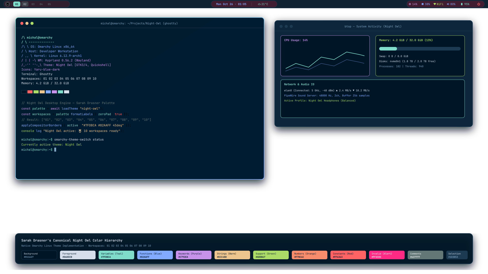

<div align="center">

# 🦉 Night Owl Desktop

### A Complete Developer-Focused Desktop Customization for Omarchy Linux & Hyprland
*Inspired by Sarah Drasner's Iconic Night Owl Color Palette*

[](https://omarchy.org/)
[](https://hyprland.org/)
[](https://quickshell.outfoxxed.me/)
[](https://github.com/sdras/night-owl-vscode-theme)

<br/>



</div>

---

## 🌌 Overview & Design Philosophy

**Night Owl** is an independent, complete desktop environment crafted for **Omarchy Linux** and **Hyprland**, built specifically for late-night software development, deep focus, and clean system workflows.

Grounding its identity in Sarah Drasner's original Night Owl palette, this customization delivers:
- **Midnight Navy Canvas (`#011627`):** Minimizes optical fatigue while keeping dark backgrounds rich and alive.
- **Teal / Cyan Indicators (`#7FDBCA`):** Restrained, high-visibility beacons for active workspaces, focused inputs, and primary buttons.
- **Function Blue (`#82AAFF`) & Keyword Violet (`#C792EA`):** Calm secondary accents for system clocks, interactive dropdowns, and category tags.
- **Zero-Padded Arabic Numerals:** Clean, modern workspace identifiers formatted as `01 02 03 04 05 06 07 08 09 10`.
- **Owl Icon Identity (`🦉`):** Quick application menu launcher and lock screen motif.

---

## 🎨 Canonical Color Palette

| Color | Token Name | Hex Code | Purpose & Desktop Role |
|:---:|:---|:---:|:---|
|  | **Background** | `#011627` | Deep dark navy workspace background & window base |
|  | **Foreground** | `#D6DEEB` | High-contrast readable body text, window titles |
|  | **Cursor** | `#80A4C2` | Cursor glyphs, subtle indicators |
|  | **Selection** | `#1D3B53` | Selected list rows, inactive window borders |
|  | **Comments** | `#637777` | Muted secondary text, inactive workspace numbers |
|  | **Constants** | `#FF6363` | Warnings, urgent workspace badges, session exit |
|  | **Numbers** | `#F78C6C` | Metric values, CPU/RAM utilization numbers |
|  | **Keywords** | `#C792EA` | Violet accents, menu highlights, secondary tags |
|  | **Functions** | `#82AAFF` | Blue accent, clock digits, secondary interactive highlights |
|  | **Strings** | `#ECC48D` | Warm accent, date labels, calendar markers |
|  | **Support** | `#ADDB67` | Green accent, Wi-Fi connected, battery full |
|  | **Variables** | `#7FDBCA` | Primary cyan/teal highlight, active workspace pill |
|  | **Invalid Syntax**| `#FF2C83` | Critical errors, battery low alerts |

---

## 🔢 Workspace Numbering

Night Owl enforces zero-padded two-digit numbering across all indicators:

`01  02  03  04  05  06  07  08  09  10`

- **Active Workspace:** Solid `#7FDBCA` pill with bold `#011627` text.
- **Occupied Workspaces:** Translucent teal tint (`rgba(127, 219, 202, 0.18)`).
- **Hovered Workspaces:** Translucent blue tint (`rgba(130, 170, 255, 0.28)`).
- **Inactive Workspaces:** Subtle muted gray-blue text (`#637777`) on transparent background.
- **Urgent Workspaces:** Warning accent `#FF6363` with dark navy text.
- **Launcher Button:** Night Owl glyph `🦉` triggering the application menu.

---

## ⚡ Quick Start

### 1. Install Night Owl
```bash
cd Night-Owl
./install.sh
```

To preview changes before applying:
```bash
./install.sh --dry-run
```

### 2. Switch Themes at Any Time
```bash
# Using native Omarchy command
omarchy theme set night-owl

# Using the theme switcher helper
./bin/omarchy-theme-switch night-owl
```

### 3. Revert to Sakurazuki
```bash
omarchy theme set sakurazuki
```

### 4. Uninstall Night Owl
```bash
./uninstall.sh
```

---

## 📂 Project Structure

- `assets/`: 2560x1440 wallpapers (`night-owl.png` and `night-owl-minimal.png`) and vector preview files.
- `bin/`: CLI switching and utility scripts (`omarchy-theme-switch`).
- `config/ghostty/`: Terminal emulator configuration.
- `config/hypr/`: Hyprland look & feel, 10px rounding, borders, drop shadows, and hyprlock configuration.
- `config/omarchy/plugins/nightowl.workspaces/`: Standalone zero-padded workspaces Quickshell widget.
- `config/omarchy/themes/night-owl/`: Complete Omarchy theme bundle (colors.toml, shell.toml, Waybar, GTK 3/4, btop, Mako, Wofi, Walker).
- `docs/`: Technical specifications, implementation report, and palette contrast audits.
- `screenshots/`: Preview captures.
