<div align="center">

# 🌸 Michal × Sakurazuki 桜月

### A Modern Japanese Cherry Blossom Desktop for Omarchy Linux & Hyprland

[](https://omarchy.org/)
[](https://hyprland.org/)
[](https://quickshell.outfoxxed.me/)
[](LICENSE)

<br/>

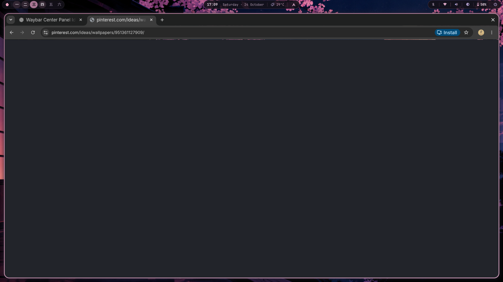

</div>

---

## ⛩️ Overview & Design Philosophy

**Sakurazuki** (桜月 — *Cherry Blossom Moon*) is a personalized, minimalist desktop customization crafted for **Omarchy Linux** and **Hyprland**. 

Inspired by peaceful Japanese spring nights, Sakurazuki fuses a rich midnight plum base with sakura blossom pink accents and moonlight lavender highlights. Every component—from the custom Kanji workspace numbers and dynamic status islands down to the 10-category main menu and high-contrast lock screen—has been tailored for seamless everyday usability, fluid performance, and aesthetic elegance.

---

## 🎨 Color Palette

| Color Swatch | Name | Hex Code | Role & Usage |
|:---:|:---|:---:|:---|
|  | **Midnight Plum** | `#14111A` | Base desktop background, main window surfaces |
|  | **Deep Plum** | `#211925` | Card backgrounds, elevated surfaces, sidebars |
|  | **Frosted Plum** | `#2A1B2A` | Popovers, dropdown menus, modal backdrops |
|  | **Sakura Rose** | `#A87692` | Active borders, focused tags, primary interactive accents |
|  | **Blossom Pink** | `#D9A6C4` | Highlight text, gradient stops, badge indicators |
|  | **Moonlight Lavender** | `#C2AEDF` | Clock digits, secondary icons, subtle highlights |
|  | **Sakura White** | `#F0DCEB` | High-contrast readable body text |
|  | **Secondary Text** | `#B8A3BB` | Subtitles, labels, descriptions |
|  | **Muted Lavender** | `#88758F` | Placeholders, inactive items, timestamps |
|  | **Plum Border** | `#443043` | Fine container borders, dividers |

---

## 📸 Visual Showcase

### Top Bar & Interactive Islands


<div align="center">

| Kanji Workspaces (`一 二 三 四 五 六`) | Center Island (Time & Weather) | System Island (Metrics) |
|:---:|:---:|:---:|
|  |  |  |

| Expanded Calendar Popover | Media & System Controls | Central Quick Power Modal |
|:---:|:---:|:---:|
| 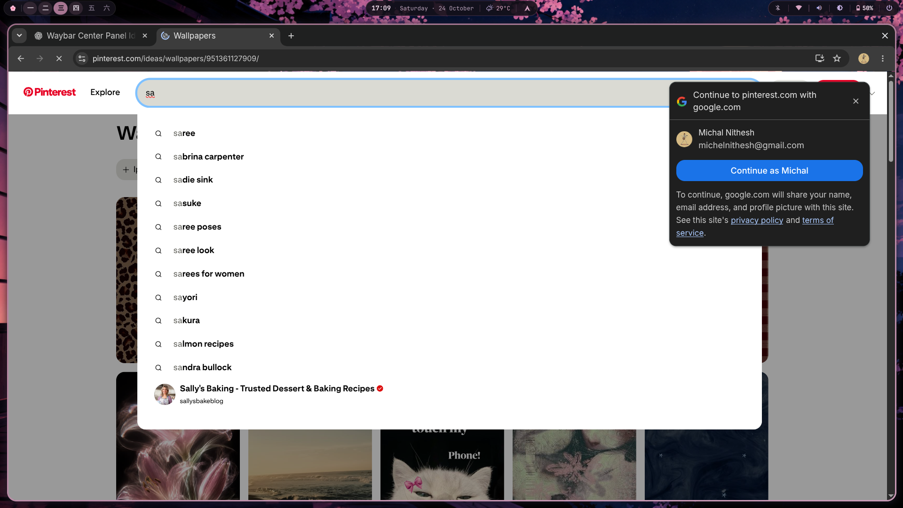 | 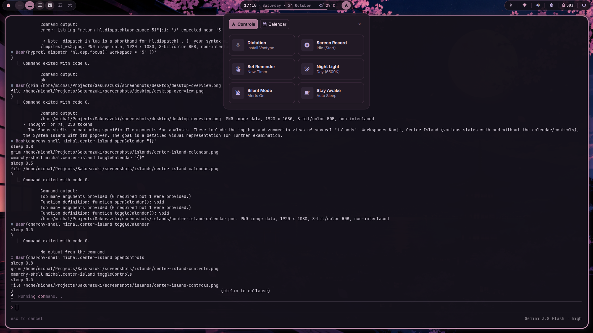 | 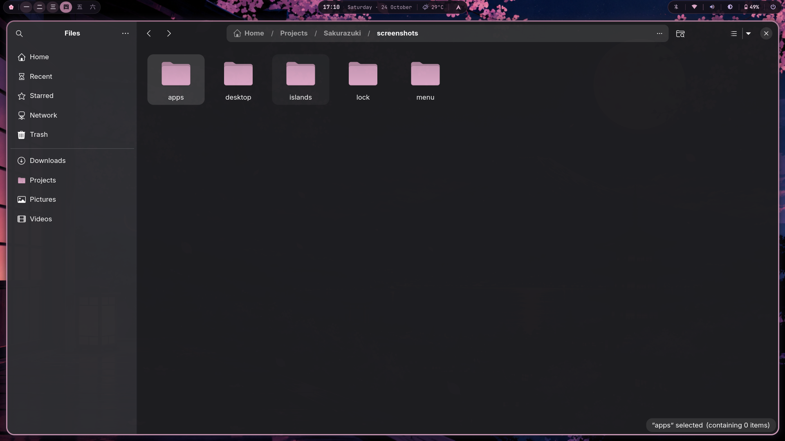 |

</div>

---

### Main Menu (10 Categories)

The unified **Michal × Sakurazuki Menu** provides fast, responsive keyboard- and mouse-friendly navigation across 10 functional domains:

<div align="center">

| 01. Apps | 02. Learn |
|:---:|:---:|
| 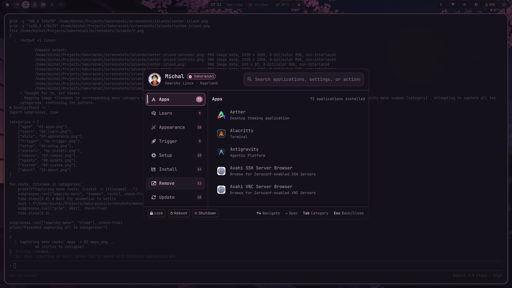 | 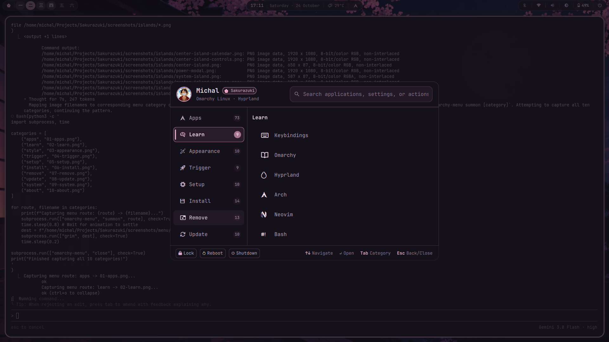 |

| 03. Appearance | 04. Trigger |
|:---:|:---:|
| 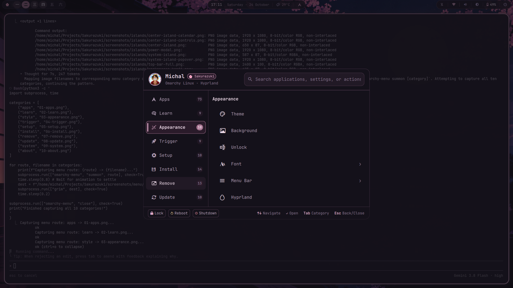 | 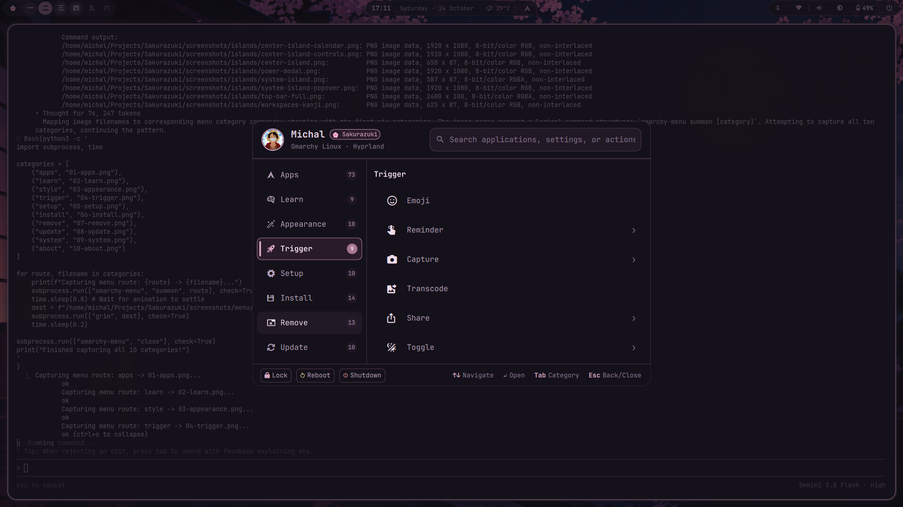 |

| 05. Setup | 06. Install |
|:---:|:---:|
| 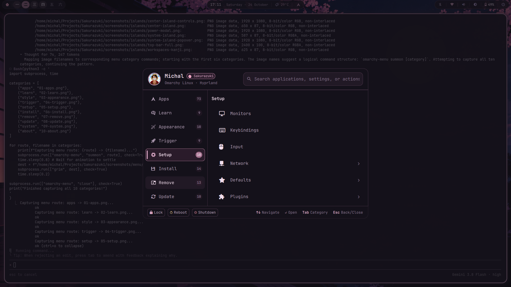 | 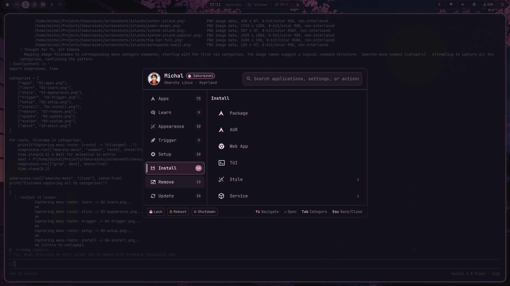 |

| 07. Remove | 08. Update |
|:---:|:---:|
|  | 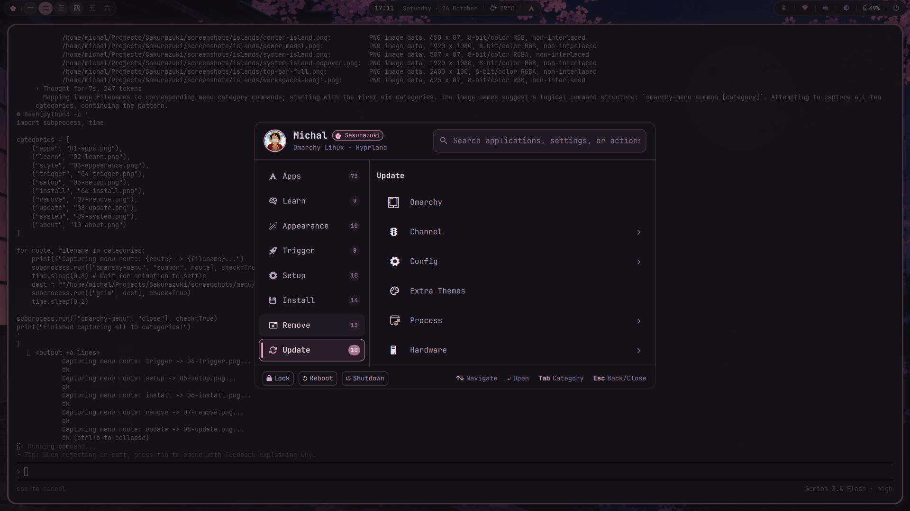 |

| 09. System | 10. About (Specs & Overview) |
|:---:|:---:|
| 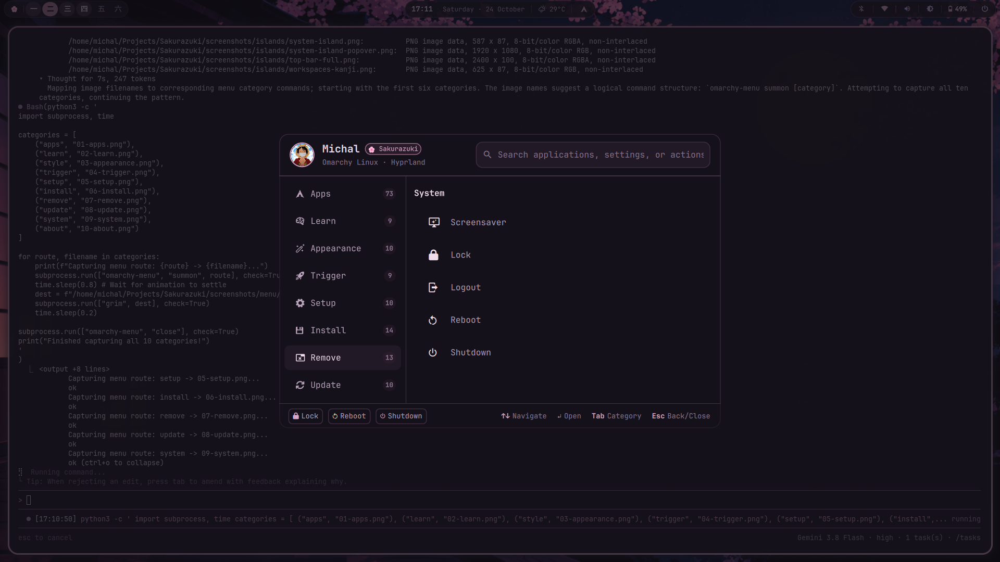 | 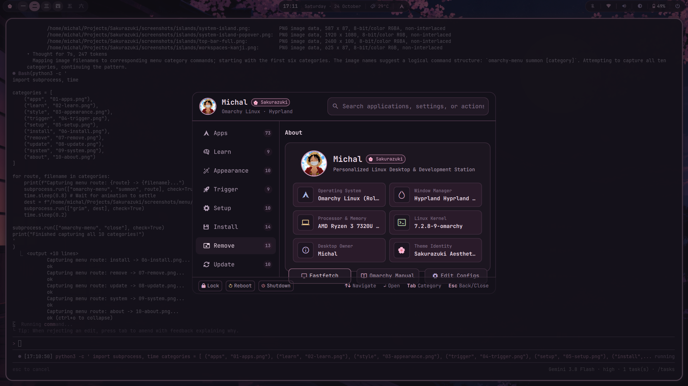 |

</div>

---

### Applications & Lock Screen

<div align="center">

| Ghostty Terminal (`fastfetch`) | Nautilus File Manager (GTK Theme) | Sakurazuki Lock Screen |
|:---:|:---:|:---:|
|  | 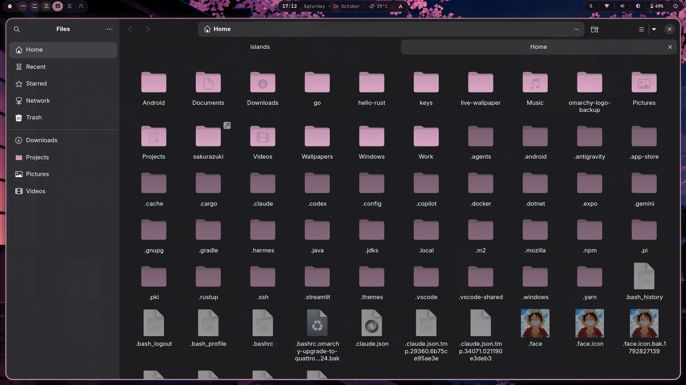 |  |

</div>

---

## 🧩 Component Architecture

Sakurazuki is built modularly on top of Omarchy Linux and Quickshell:

- **`michal.workspaces`:** Top-left bar widget featuring Japanese Kanji numeral badges (`一` through `六`) and an interactive cherry blossom launcher button (`🌸`).
- **`michal.center-island`:** Centered digital clock, live local weather indicator, and popovers for a full monthly calendar and media playback controls.
- **`michal.system-island`:** Top-right cluster displaying Bluetooth, Wi-Fi, Audio volume, Display brightness, and Battery status. Features an expandable 5-tab settings popover and a centered 4-button Power modal.
- **`michal.menu`:** Re-engineered Omarchy menu with dynamic application discovery, categorized actions, fuzzy search, and a personal branding overview.
- **`michal.lock`:** Modern session lock screen with high-contrast typography, PAM password authentication, and custom circular avatar framing.
- **Hyprland Look & Feel:** 14px window corner rounding, 45-degree dual gradient sakura borders, frosted glass blur, and custom cubic bezier transitions (`sakuraEase`).

---

## ⚡ Quick Start

### 1. Clone the Repository
```bash
git clone https://github.com/Michal-Nithesh/Sakurazuki.git
cd Sakurazuki
```

### 2. Run the Safe Installer
The installer creates automatic timestamped backups of any pre-existing configuration before deploying:
```bash
./install.sh
```

To test before installing:
```bash
./install.sh --dry-run
```

### 3. Uninstallation
To revert your configuration back to its original state:
```bash
./uninstall.sh
```

---

## ⌨️ Useful Keybindings

| Keybinding | Action |
|---|---|
| `SUPER + RETURN` | Open Ghostty terminal |
| `SUPER + B` | Launch default web browser |
| `SUPER + SHIFT + F` | Open Nautilus file manager |
| `SUPER + C` | Launch Visual Studio Code / Editor |
| `SUPER + Q` | Close active window |
| `SUPER + TAB` | Switch windows (Mission Control style) |
| `SUPER + 1..6` | Switch to workspace 1 through 6 |
| `SUPER + SHIFT + 1..6`| Move active window to workspace 1 through 6 |

---

## 📚 Documentation Index

- [Installation & Prerequisites Guide](docs/installation.md)
- [Component Inventory & IPC Hooks](docs/component-inventory.md)
- [Customization & Color Guide](docs/customization.md)
- [Troubleshooting & FAQ](docs/troubleshooting.md)
- [Complete Screenshot Gallery](docs/screenshots.md)

---

## 📄 License & Credits

- **Desktop Author & Customization:** Michal Nithesh
- **Theme Name:** Sakurazuki 桜月
- **Base System:** [Omarchy Linux](https://omarchy.org/) by Basecamp
- **Compositor:** [Hyprland](https://hyprland.org/) by Vaxry
- **Shell Engine:** [Quickshell](https://quickshell.outfoxxed.me/) by Outfoxxed
- **License:** [MIT License](LICENSE)
