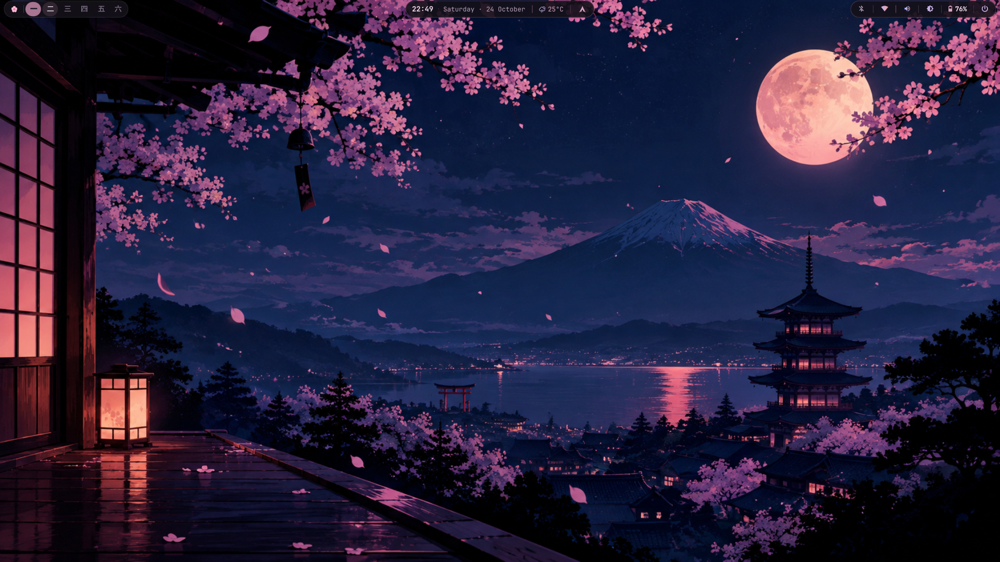
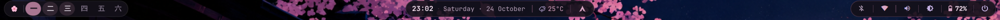
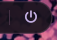
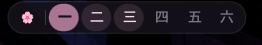
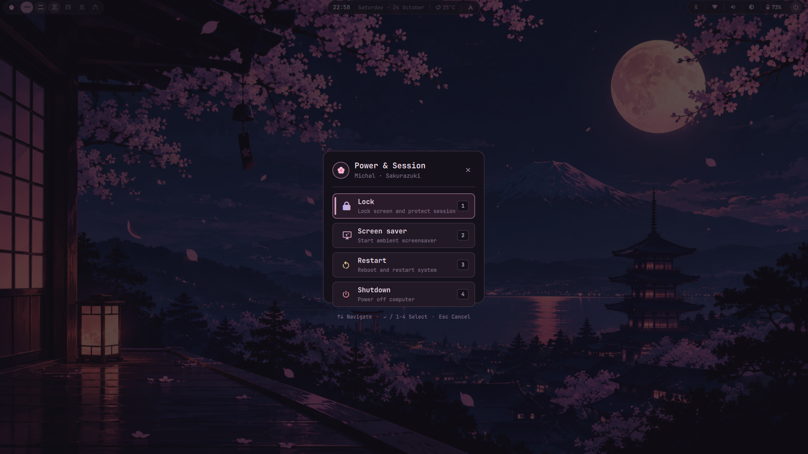

# 🌸 Michal × Sakurazuki 桜月

### A Modern Japanese Cherry Blossom Desktop for Omarchy Linux & Hyprland

[](https://omarchy.org/)
[](https://hyprland.org/)
[](https://quickshell.outfoxxed.me/)
[](LICENSE)

<br/>



---

## ⛩️ Overview & Design Philosophy

**Sakurazuki** (桜月 — *Cherry Blossom Moon*) is a refined, bespoke desktop customization created for **Omarchy Linux** and **Hyprland**.

Inspired by peaceful Japanese spring nights, Sakurazuki fuses a rich midnight plum background with cherry blossom pink highlights, rose accents, and moonlight lavender tones. Every desktop element—from the custom Kanji workspace numerals and floating status islands down to the 10-category application menu, ambient screensaver, and high-contrast lock screen—is designed for elegance, fluidity, and everyday usability.

---

## 🎨 Color Palette

| Swatch | Name | Hex Code | Role & Usage |
|:---:|:---|:---:|:---|
| `■` | **Midnight Plum** | `#14111A` | Main desktop background, window base |
| `■` | **Deep Plum** | `#211925` | Card backgrounds, elevated surfaces |
| `■` | **Frosted Plum** | `#2A1B2A` | Popovers, modal backgrounds, dropdowns |
| `■` | **Sakura Rose** | `#A87692` | Active borders, focused tags, interactive accents |
| `■` | **Blossom Pink** | `#D9A6C4` | Highlight text, gradient stops, badge indicators |
| `■` | **Moonlight Lavender** | `#C2AEDF` | Clock digits, secondary icons, subtle highlights |
| `■` | **Sakura White** | `#F0DCEB` | High-contrast readable body text |
| `■` | **Secondary Text** | `#B8A3BB` | Subtitles, labels, descriptions |
| `■` | **Plum Border** | `#443043` | Fine container borders and dividers |

---

## 🌟 Key Features

### 🌸 Quickshell Floating Islands & Status Bar
- **Floating Island Bar (`michal.bar`)**: Top-anchored floating bar with subtle translucency, rounded corners, and island geometry.
- **Kanji Workspaces (`michal.workspaces`)**: Native Quickshell widget displaying Japanese Kanji numerals (`一 二 三 四 五 六`) with smooth active indicator transitions.
- **Center Island (`michal.center-island`)**: Houses live digital clock, calendar popover, weather updates, and quick toggles for night light, DND, and stay awake.
- **System Telemetry Island (`michal.system-island`)**: Real-time CPU, RAM, network, audio, and battery metrics with expandable telemetry popover.
- **10-Category Application Menu (`michal.menu`)**: Full-screen organized application launcher with categorised discovery and fast keyboard navigation.
- **Lock Screen (`michal.lock`)**: Minimalist, high-contrast lock screen with smooth authentication and instant display wake.

### 🪟 Hyprland Aesthetics
- **Borders & Shadows**: Dynamic Sakura gradient active border (`#A87692` → `#D9A6C4` 45°), plum container inactive borders (`#443043`), and soft drop shadows.
- **Smooth Geometry**: Consistent 14px border radius across windows, menus, and islands.

### 🌙 Ambient Screensaver
- **CLI Animation Daemon**: Integrated terminal screensaver powered by `ttfx` and `foot`, displaying matrix, rain, and particle effects in cherry blossom colors over `Screensaver.png`.
- **Instant Transition**: Seamless zero-animation transition to screensaver workspace and instant dismissal on input.

### 🖼️ Asset Suite
- **Custom Icon Pack**: Tailored `Sakurazuki` SVG folder icon pack matching the plum and blossom palette.
- **Wallpapers & Avatars**: High-resolution wallpaper (`Sakurazuki Moonlit Valley Retreat.png`) and custom user avatars.

### 🖥️ Turnkey Application Theming
- Cohesive styling across **Ghostty**, **Foot**, **Alacritty**, **Kitty**, **Neovim**, **VSCode**, **GTK 3/4**, **Btop**, **SwayOSD**, **Mako**, **Walker**, and **Wofi**.

---

## 📸 Visual Showcase

### Top Bar & Interactive Islands


```carousel

<!-- slide -->

<!-- slide -->

<!-- slide -->

```

---

## 📁 Repository Structure

```
Omarchy-theme/
├── Sakurazuki/                 # Sakurazuki Desktop Distribution
│   ├── README.md               # Theme details and features
│   ├── install.sh              # Autonomous installer with backup support
│   ├── uninstall.sh            # Autonomous uninstaller with rollback
│   ├── bin/                    # Screensaver & wake utility scripts
│   ├── assets/                 # Wallpapers, avatars, custom icon pack
│   ├── config/                 # Hyprland, Ghostty, and Quickshell plugins
│   ├── docs/                   # Component inventory, customization & audits
│   └── screenshots/            # Showcase desktop captures
│
├── docs/                       # Architectural & Installation Documentation
│   ├── architecture.md         # System design and component boundaries
│   └── installation.md         # Step-by-step setup and troubleshooting
│
├── README.md                   # Repository overview (this file)
├── LICENSE                     # MIT License
└── .gitignore                  # Git repository ignore patterns
```

---

## ⚡ Quick Start

### 1. Prerequisites
Ensure you are running **Omarchy Linux (v4.0.0+)** on Arch Linux with Hyprland and Quickshell installed:
- `hyprland`
- `quickshell` (`omarchy-shell`)
- `ghostty` or `foot`
- `hyprlock`
- `python3`
- `grim` & `slurp`
- `ttfx` *(optional, for screensaver animations)*

### 2. Installation
Run the autonomous installer directly from `Sakurazuki/`:
```bash
cd ~/Projects/Omarchy/Sakurazuki
./install.sh
```

To preview changes before applying them:
```bash
./install.sh --dry-run
```

The installer automatically:
1. Creates a timestamped backup of your current configurations in `~/.config/omarchy/backups/`.
2. Deploys custom Quickshell plugins (`michal.*`) to `~/.config/omarchy/plugins/`.
3. Deploys theme files, wallpapers, avatars, and icon theme.
4. Deploys Hyprland look & feel and screensaver scripts.
5. Activates the theme via `omarchy theme set sakurazuki`.

### 3. Activation
If you need to manually re-activate Sakurazuki at any time:
```bash
omarchy theme set sakurazuki
```

### 4. Uninstallation
To revert your configuration back to its pre-install state:
```bash
cd ~/Projects/Omarchy/Sakurazuki
./uninstall.sh
```

---

## ⌨️ Useful Keybindings

| Keybinding | Action |
|---|---|
| `SUPER + RETURN` | Open Ghostty terminal |
| `SUPER + B` | Launch default web browser |
| `SUPER + SHIFT + F` | Open Nautilus file manager |
| `SUPER + C` | Launch Visual Studio Code / Editor |
| `SUPER + Q` | Close active window |
| `SUPER + TAB` | Switch windows (Mission Control style) |
| `SUPER + 1..6` | Switch to workspace 1 through 6 |
| `SUPER + SHIFT + 1..6` | Move active window to workspace 1 through 6 |

---

## 🔧 Troubleshooting

### Status Bar Missing or Hidden After Sleep
If the status bar is ever hidden after waking from sleep or closing the screensaver:
```bash
omarchy-system-wake
```
Or force a Quickshell bar sync:
```bash
omarchy-shell -q omarchy.bar syncHidden
```

### Refresh Desktop Shell
To reload all active Quickshell plugins without restarting your session:
```bash
omarchy restart shell
```

### Reload Hyprland Configuration
To re-evaluate window rules, borders, and animations:
```bash
hyprctl reload
```

---

## 📖 Documentation Index

- [Architecture & System Design](docs/architecture.md)
- [Installation & Setup Guide](docs/installation.md)
- [Sakurazuki Component Inventory](Sakurazuki/docs/component-inventory.md)
- [Customization Guide](Sakurazuki/docs/customization.md)
- [Troubleshooting Reference](Sakurazuki/docs/troubleshooting.md)

---

## 📜 License

This project is licensed under the MIT License — see the [LICENSE](LICENSE) file for details.
