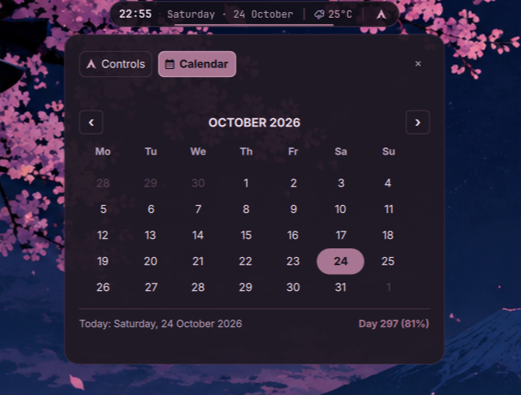
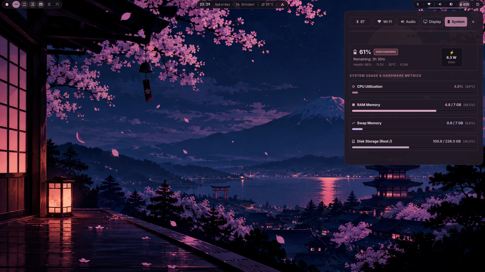
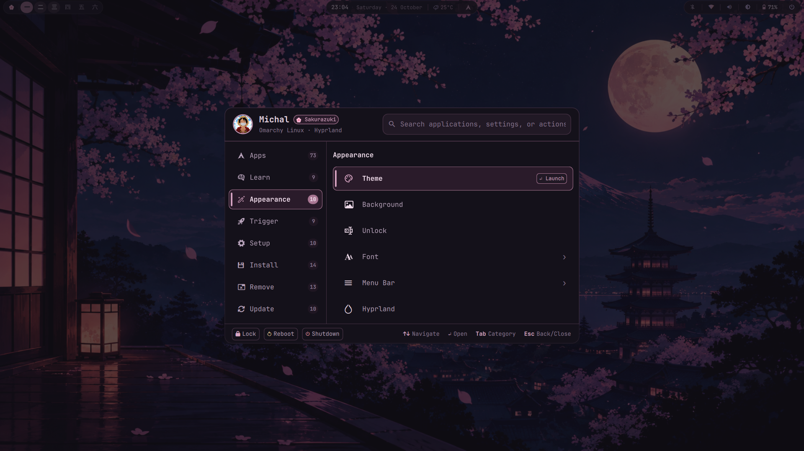
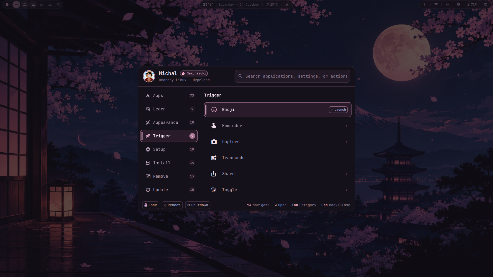
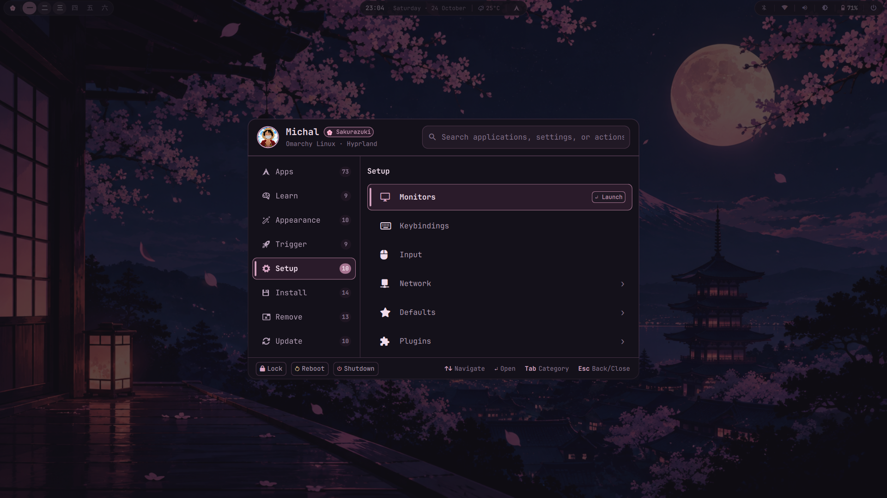
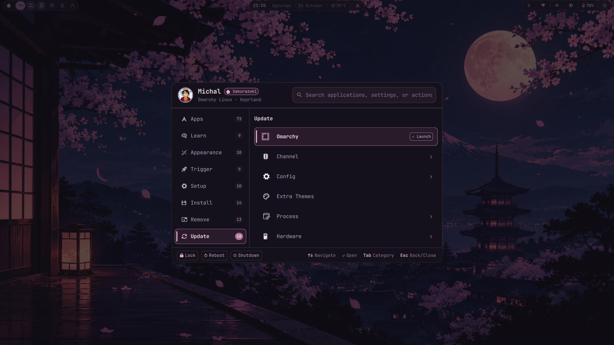
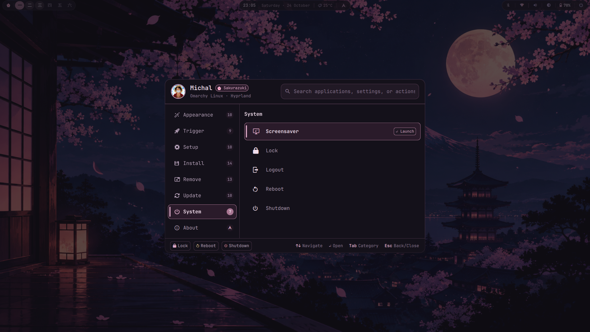
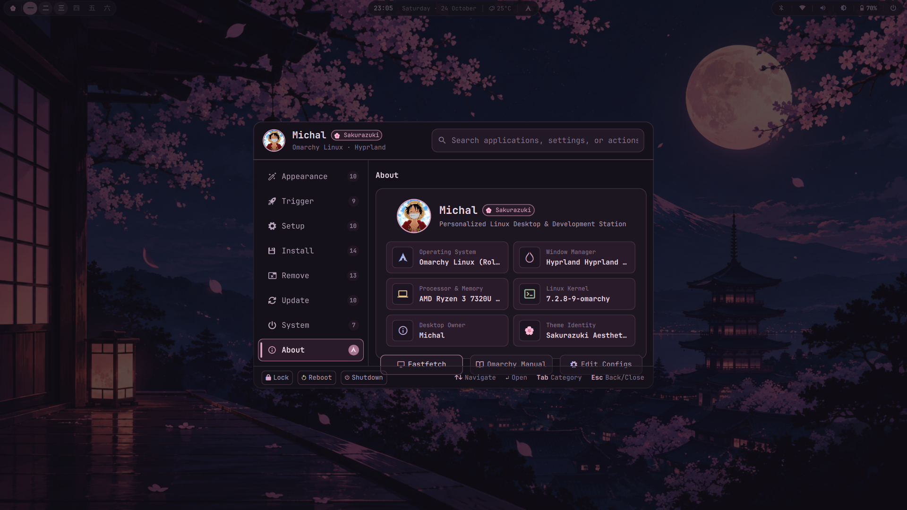
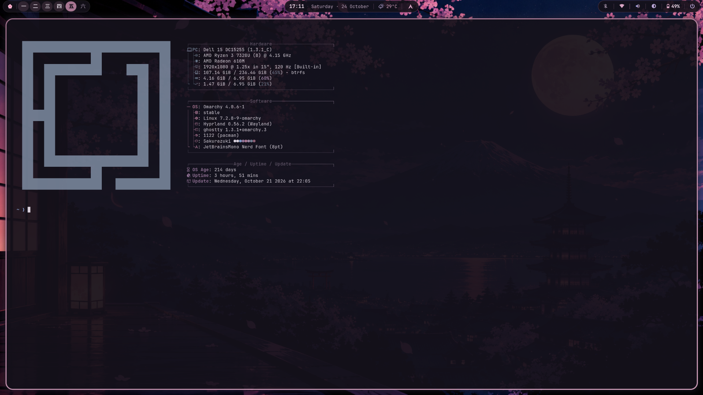
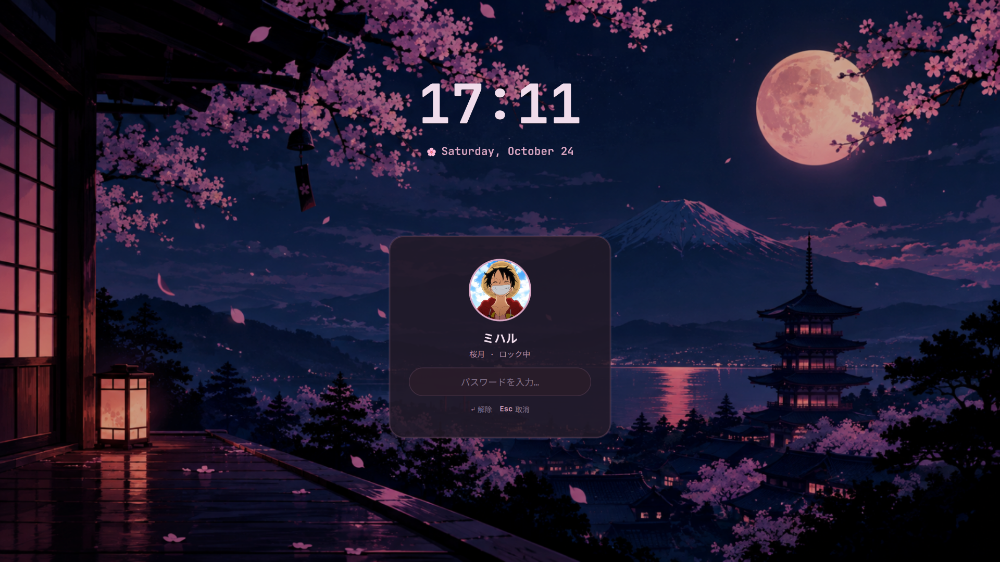

# Screenshot Gallery — Michal × Sakurazuki

A visual walkthrough of all captured real UI pages in the **Michal × Sakurazuki** desktop environment.

---

## 1. Desktop & Overview

### Desktop Overview
A clean, minimal view of the Sakurazuki desktop with the customized floating top bar, cherry blossom wallpaper, and frosted glass elements.

---

## 2. Top Bar & Island Widgets

### Workspaces Kanji Bar
Japanese Kanji numerals (`一 二 三 四 五 六`) inside a floating plum container with the cherry blossom launcher (`🌸`).

### Center Island (Time & Weather)
Displaying digital clock and live weather condition metrics.

### Center Island Calendar Popover
Expanded monthly calendar with smooth plum backdrop and date indicators.

### Center Island Controls Popover
Media controls, current track info, and quick playback switches.

### System Island (Metrics & Quick Indicators)
Status cluster with Bluetooth, Wi-Fi, Audio, Brightness, and Battery indicators.

### System Island Popover
Interactive tabs for Bluetooth, Wi-Fi, Audio, Display, and System metrics.

### Central Power Modal
Floating plum card with quick buttons for Lock, Screensaver, Restart, and Shutdown.

---

## 3. Main Menu (All 10 Categories)

### 01. Apps Category
Dynamic grid of installed desktop applications with search filter and Arch badge.

### 02. Learn Category
Quick links to keybindings documentation, Omarchy manual, Arch wiki, and Hyprland resources.

### 03. Appearance Category
Theme switcher, wallpaper selectors, window gaps toggles, and layout controls.

### 04. Trigger Category
Quick desktop triggers: Stay Awake, night light, clipboard manager, emoji picker, reminders, and screenshot tools.

### 05. Setup Category
System configuration: display settings, keybinding management, touchpad setup, and default browser/terminal.

### 06. Install Category
Curated software and package manager installer for developer tools, media, and utilities.

### 07. Remove Category
Package removal interface for unneeded desktop applications.

### 08. Update Category
System update center: pacman system updates, AUR updates, mirror ranking, and firmware upgrades.

### 09. System Category
Hardware monitoring, disk space analyzer, power profile switches, and session management.

### 10. About Category
Michal × Sakurazuki system overview, personal avatar, Arch icon package counter pill, and categorized hardware spec cards.

---

## 4. Application Windows & Lock Screen

### Ghostty Terminal
Custom terminal styling with 16-color Sakurazuki palette, blurred background, and `fastfetch` system information.

### Nautilus File Manager
File manager rendered with Sakurazuki dark plum GTK styling and custom folder icons.

### Sakurazuki Lock Screen
Crisp Japanese aesthetic lock screen with minimalist digital clock, circular avatar, and Japanese password field.

